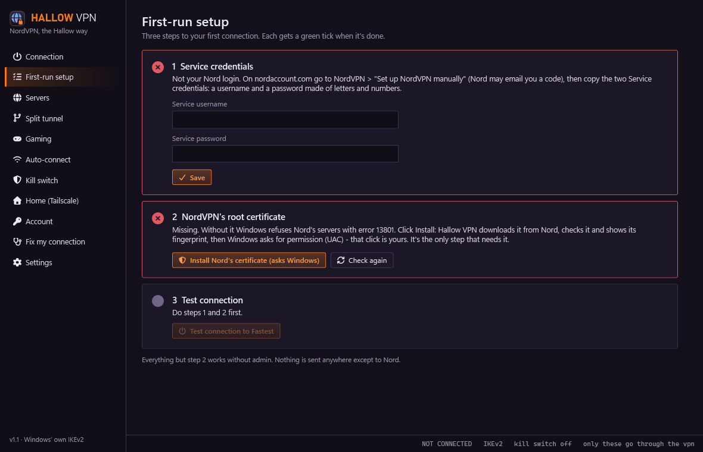
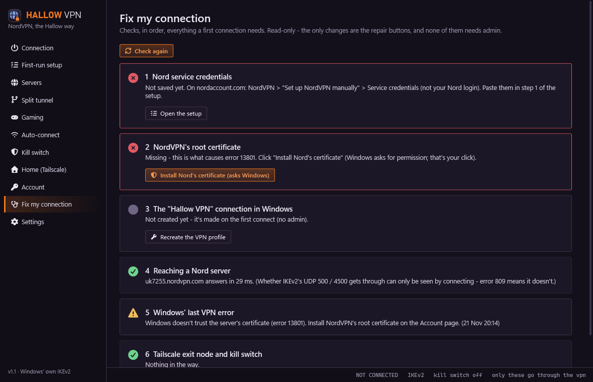
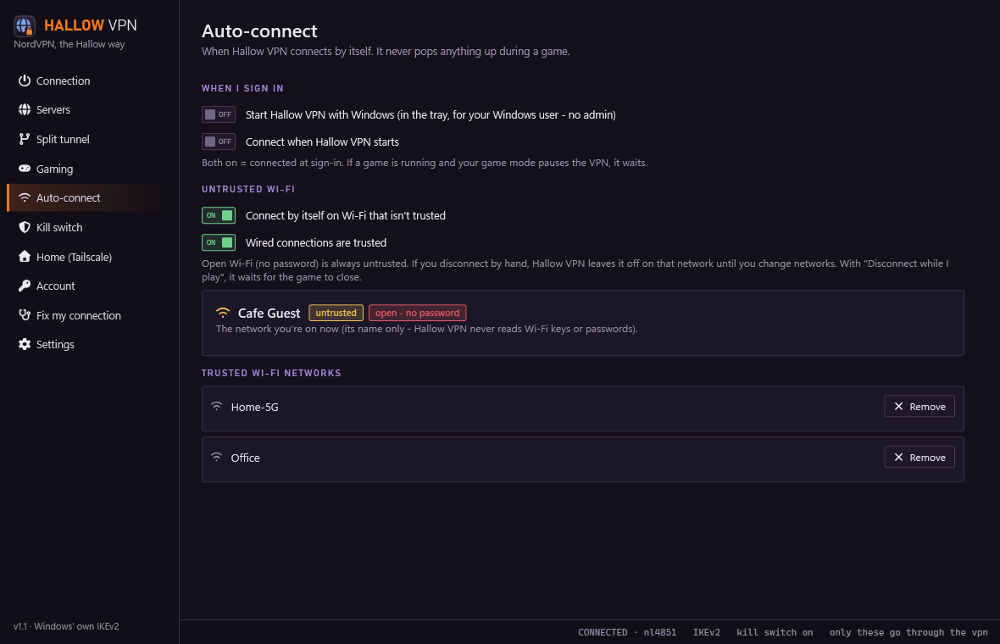
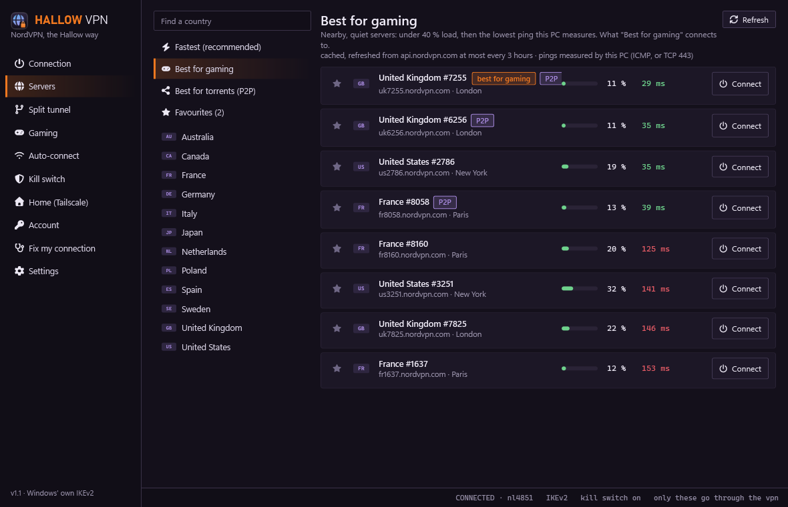

# Hallow VPN

**A game-aware VPN client for your NordVPN subscription - on Windows' own IKEv2 VPN client.**

Part of the Hallow family of Windows apps. Hallow VPN uses the NordVPN subscription you already have, through the VPN client
built into Windows: **no NordVPN app, no drivers, nothing else to download, no admin** for everyday use. It knows when you're
playing: it can pause the VPN for your game and reconnect after, or move you to a low-ping server.

## New in 1.1: first connect just works, and nothing leaks

- **First-run setup**: a step-by-step screen that opens until your first successful connection (and from Settings any time):
  **1** the service credentials (with the same checks as before and where to find them), **2** NordVPN's root certificate -
  installed or missing, with the Install button (Windows asks - UAC - and that click is yours), **3** *Test connection to
  Fastest* with a plain pass / fail. Each step gets a green tick or a plain-English fix.

  
- **Fix my connection**: read-only checks, in order - credentials saved, certificate installed, the "Hallow VPN" profile there
  and set up as expected (IKEv2 only, a Nord server, Nord's DNS), a Nord server that resolves and answers a ping, Windows' last VPN
  error explained (13801, 691, 809...), and whether Tailscale's exit node or a half-installed kill switch is in the way. Repairs
  that need no admin are one click: **recreate the per-user profile** and **refresh the server list**. The pipe has `diagnose`.

  
- **DNS leak protection** (no admin): Windows' `Set-VpnConnection` has no DNS option, so Hallow VPN edits **only the "Hallow VPN"
  entry** of your per-user phonebook (`%APPDATA%\Microsoft\Network\Connections\Pbk\rasphone.pbk`): `IpNameAssign=2`,
  `IpDnsAddress=103.86.96.100`, `IpDns2Address=103.86.99.100` (NordVPN's DNS) and `IpInterfaceMetric=1` (Windows asks the VPN's
  DNS first). The file is backed up first (`%APPDATA%\HallowVPN\rasphone.pbk.bak`) and replaced atomically; other connections are
  left byte for byte. With split tunnel "Only these" the entry goes back to automatic DNS (Nord's DNS isn't reachable outside the tunnel).
- **Leak test** while connected (Connection page): your public IPv4 from Nord's IP check (and whether Nord calls it "protected"),
  which DNS servers Windows asks and whether they go through the VPN (read from Windows' own per-interface settings - no third-party
  test sites), and an **IPv6** warning: Nord's IKEv2 carries IPv4 only, so on a PC with IPv6 internet, IPv6 traffic can go around
  the VPN unless the kill switch is on (it blocks public IPv6). Adapter settings are never changed. **Show my real IP** asks Nord's IP
  check once through your normal connection - only when you click, never saved. status.json gets `leakCheck` (`ok` / `warn` /
  `fail`) and `leakCheckAt` - never the addresses.
- **Auto-connect** (new page): start with Windows + connect at start (= connected at sign-in, per-user Run key, no admin), and
  **connect on untrusted Wi-Fi**: any Wi-Fi not on your trusted list; **open Wi-Fi (no password) is always untrusted**; wired counts
  as trusted unless you switch that off. The Wi-Fi name comes from Windows' Native Wifi API (the current connection only) - never
  profiles, keys or passwords. If you disconnect by hand it stays off on that network; with "Disconnect while I play" it waits for
  the game to close; nothing pops up during a game.

  
- **Best for torrents**: Nord's P2P servers (recommendations with `filters[servers_groups][identifier]=legacy_p2p` - group 15, "P2P"),
  on the Servers page, the Connection page, Hub's menu and the pipe (`connect p2p`).
- **Connection health**: data sent / received (RasGetConnectionStatistics), a live ping to the server and a *slow server? switch*
  hint when the ping is over 150 ms or the server is 75 % busy. Read every 2 s at most, only while the Connection page is showing
  and the window isn't minimised.

## What it does

- **Account**: paste your Nord **service credentials** (Nord Account > NordVPN > *Set up NordVPN manually* > Service credentials).
  They are **not your Nord login** - Hallow VPN refuses an email address and says where to find the right ones. They're stored in
  `%APPDATA%\HallowVPN\account.dat`, encrypted with **Windows DPAPI for your Windows user** (CurrentUser), and never logged, never
  in status or the family pipe, never in crash reports and never on a command line.
- **Servers** from Nord's **public server API** (no key): `v1/servers/recommendations` with the IKEv2 filter, per country with
  `filters[country_id]`, and the country list. Cached in `servers.json` and refreshed **at most every 3 hours** (a manual Refresh at
  most every 5 minutes). Each server shows its country, city, **load** and a **ping measured by this PC** (ICMP echo, or the time a
  TCP connection to port 443 takes when ICMP gets no answer). Choices: **Fastest** (ping + 0.8 x load), **by country**,
  **favourites** (star any server) and **Best for gaming** (nearby and quiet: under 40 % load, then the lowest ping).

  
- **Connect** with Windows' own IKEv2 client: one **per-user** VPN connection called "Hallow VPN" (PowerShell `Add-VpnConnection`
  / `Set-VpnConnection` **without** `-AllUserConnection`, so no admin): IKEv2, EAP (EAP-MSCHAPv2), encryption required, credentials
  **not** remembered by Windows. It's dialled with `RasDial` **inside Hallow VPN** with the service credentials, so the password is
  never on a command line (no `rasdial <user> <pass>`). The Connection page shows the server, protocol, **connected time** and your
  **public IP** - fetched from Nord's own IP check (`api.nordvpn.com/v1/helpers/ips/insights`) **only while connected**.
  **Auto-reconnect** (3 s, 10 s, 30 s ... up to 5 minutes) when the connection drops.
- **NordVPN's root certificate**: Windows' IKEv2 client only accepts servers whose certificate it trusts, and Nord's servers use
  NordVPN's own root ("NordVPN Root CA"), which Windows doesn't include. Hallow VPN **checks** for it (read-only) and offers an
  **Install** button: it downloads Nord's file (`downloads.nordcdn.com`) only when you click, checks it is NordVPN's self-signed root
  CA without a private key, shows its fingerprint, and then Windows asks (UAC) - it's a change to the computer's Trusted Root store.
  Never silently. A matching **Remove** button.
- **Split tunnel** - honest version: Windows' built-in client splits by **address** (routes), not by app; per-app split
  tunnelling needs a network driver and Hallow VPN installs none. So: **Everything through the VPN**, **Only these go through the
  VPN** (addresses, ranges, websites - the profile's SplitTunneling + one route each, websites looked up on each connect), or
  **Everything except games** (everything through Nord, but the VPN pauses while a game runs).

  
- **Game-aware**: the family game list (DeltaForceClient-Win64-Shipping.exe, Discovery-d.exe, your own exe names) plus Hallow Hub's
  `playing`. When a game starts: **do nothing**, **disconnect and reconnect 10 s after it closes**, or **stay connected on a low-ping
  server** (and back to your choice after). Nothing pops up while you play - notifications are held.
- **Kill switch** (optional, **asks Windows**): Windows Firewall outbound **block** rules on Wi-Fi and wired connections for TCP, UDP
  and ICMP to public internet addresses, **except** IKEv2 to the VPN server (UDP 500 / 4500) and DNS (port 53). The VPN's own
  connection, your home network, Tailscale's 100.64.0.0/10 and link-local addresses stay reachable. Installing and removing it
  runs Hallow VPN elevated with one fixed command after Windows' UAC prompt - the user clicks. See the limits below.
- **Home** (Tailscale): if Tailscale is installed, "Route through my home" lists only the machines Tailscale reports as **exit-node
  capable** and switches with `tailscale set --exit-node=<ip>` (and back with `--exit-node=`). It uses your **home** connection -
  websites see your home's address, and it **doesn't hide your traffic from your home internet provider**.
- **Hallow family**: the pipe `HallowFamily.VPN.<user>` (`ping`, `status`, `connect [fastest|gaming|p2p|<country code>|<server>]`,
  `disconnect`, `menu`, `open [page]`, `invoke <id>`, `diagnose`, `leaktest`, `quit`), `HallowVPN.exe --cmd "<line>"`, `%APPDATA%\HallowVPN\status.json`
  (`connected`, `connecting`, `server`, `country`, `protocol`, `killSwitch`, `splitMode`, `since` - Hallow Torrents reads these;
  1.1 adds `p2p` (true while connected to one of Nord's P2P servers - so Hallow Torrents can prefer them later), `leakCheck`
  (`ok` / `warn` / `fail`, or null when not connected / not checked yet), `leakCheckAt`, `setupDone`, `untrustedNetwork` and
  `autoConnect`; never an address, a Wi-Fi name or the credentials),
  Hallow Hub's tray menu (Hub 2.13+ lists any app answering `menu`), the Hallow accent and **light / dark mode** from
  `%APPDATA%\Hallow\theme.json` (or its own Look setting), crash reports kept on this PC, and the GitHub updater (checks the
  download's SHA-256).

  

## Limits (honest)

- **Split tunnelling is route-based, not per app** (see above). With "Only these", DNS lookups use your normal connection.
- **Kill switch**: Windows Firewall block rules always win over allow rules, so it's done by blocking everything else. Rarer IP
  protocols (not TCP / UDP / ICMP) aren't blocked; DNS lookups (port 53) and IKEv2 (UDP 500 / 4500) to any address still go out; it
  works only while Windows Firewall is on. While it's installed, **no VPN = no internet** - so "disconnect while gaming" becomes
  "low-ping server", and Home mode needs it removed first.
- **DNS**: Windows may still send a lookup to another network's DNS (your router) as a fallback if Nord's DNS is slow - that's
  Windows' smart multi-homed name resolution, and turning it off is a Group Policy that needs admin, so Hallow VPN doesn't. The
  leak test says so when it applies. The phonebook keys take effect on the next connect.
- **IPv6** isn't carried by Nord's IKEv2; Hallow VPN warns instead of changing your adapters. The kill switch blocks public IPv6.
- **Leak test**: it can't test WebRTC (a browser thing). "Show my real IP" doesn't work while the kill switch is on - that's the
  kill switch working.
- **Connection test**: whether UDP 500 / 4500 get through can only be seen by connecting (error 809 means they don't); the checks
  stop at "the server resolves and answers a ping".
- **Untrusted Wi-Fi** is read every 5 seconds while Hallow VPN runs; only the Wi-Fi name and whether it has a password.
- Quitting Hallow VPN leaves the VPN connection as it is (Windows keeps it). Auto-reconnect and game awareness only work while
  Hallow VPN runs.
- Hallow VPN isn't made by or affiliated with Nord Security.

## Install

1. Download `Hallow.VPN.zip` from the [latest release](https://github.com/Dom428/hallow-vpn/releases/latest).
2. Right-click the zip > Properties > tick **Unblock** > OK, then Extract All.
3. Double-click `INSTALL.bat` (no admin needed). It installs to `%LOCALAPPDATA%\Programs\Hallow VPN` with Start menu and
   Desktop shortcuts and an entry in Windows' Apps list. Settings live in `%APPDATA%\HallowVPN`. Uninstalling removes the
   "Hallow VPN" connection and offers to remove the kill switch.

Or install it from [Hallow Setup](https://github.com/Dom428/hallow-setup).

## Build

Built with the C# compiler that ships with Windows (.NET Framework 4.8): run `build.ps1` (`build.ps1 -Tests` also builds
`tests\VpnTests.exe`). WPF in code, `src\Theme.xaml` embedded (light mode swaps its values). `HallowVPN.exe --snap <folder>`
renders every page in dark and light with made-up data.

Tests (`tests\VpnTests.exe`): Nord API parsing from fixtures (one is a real answer saved once), picking, the 3-hour cache,
split-tunnel parsing and the profile script, DPAPI storage and crash-report blanking, the kill switch rules (built, never added),
the certificate check (with certificates made up in memory), Tailscale parsing, game modes, light / dark contrast, and the family
pipe of a test copy where the VPN layer, firewall, Tailscale and games are **fakes**. 1.1 adds the phonebook DNS edit (on temp
copies only), P2P parsing (a real P2P answer and Nord's group list saved once), the leak verdict, untrusted networks, the checks
of "Fix my connection", and in the test copy: `connect p2p`, the leak test, auto-connect on open Wi-Fi (fake network), the setup
test and the profile repair. The only real calls are read-only: `RasEnumConnections`, `RasDial` against an empty test phonebook
(no entry, nothing dialled), `RasGetConnectionStatistics` with no connection, the firewall rule list, the certificate store,
`tailscale status --json`, the network interfaces and their metrics, and the Native Wifi current connection (the name is never printed).

## Credits

Icons: [Font Awesome Free](https://fontawesome.com) 7.3.1 by Fonticons, Inc., licensed CC BY 4.0 - see `FontAwesome-LICENSE.txt`.
NordVPN is a trademark of Nord Security; Hallow VPN only uses your own subscription through Nord's manual-setup credentials.